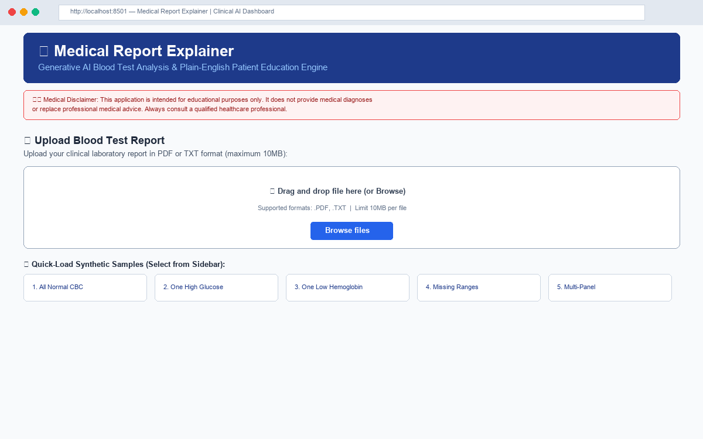
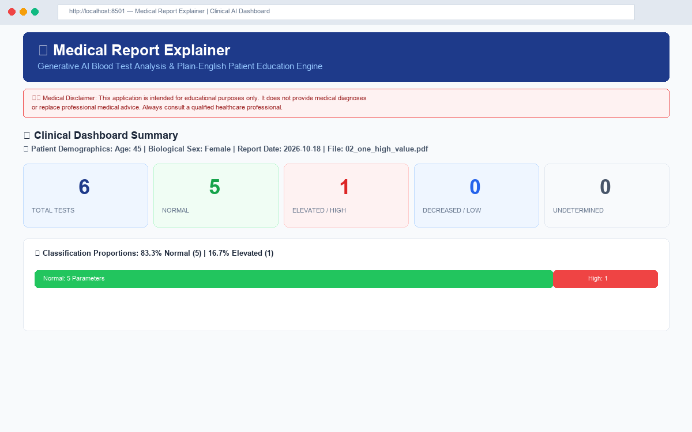
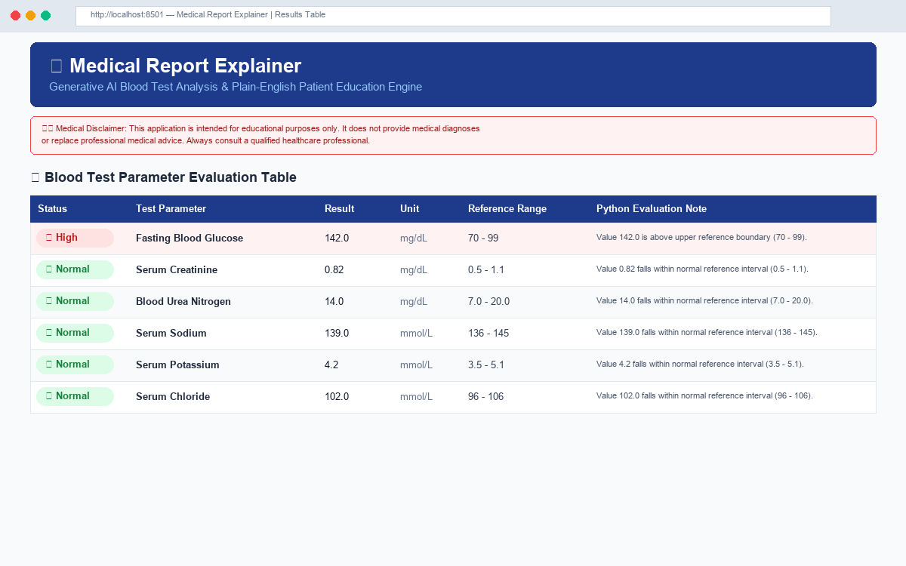
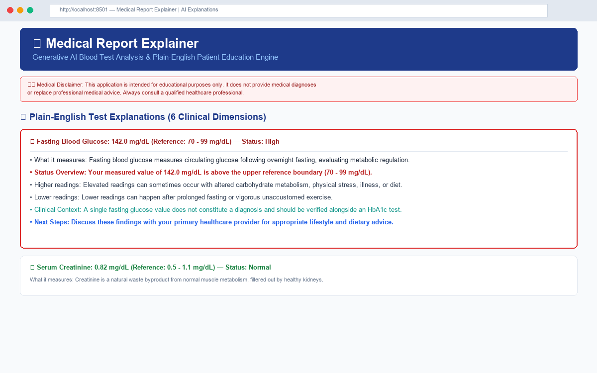
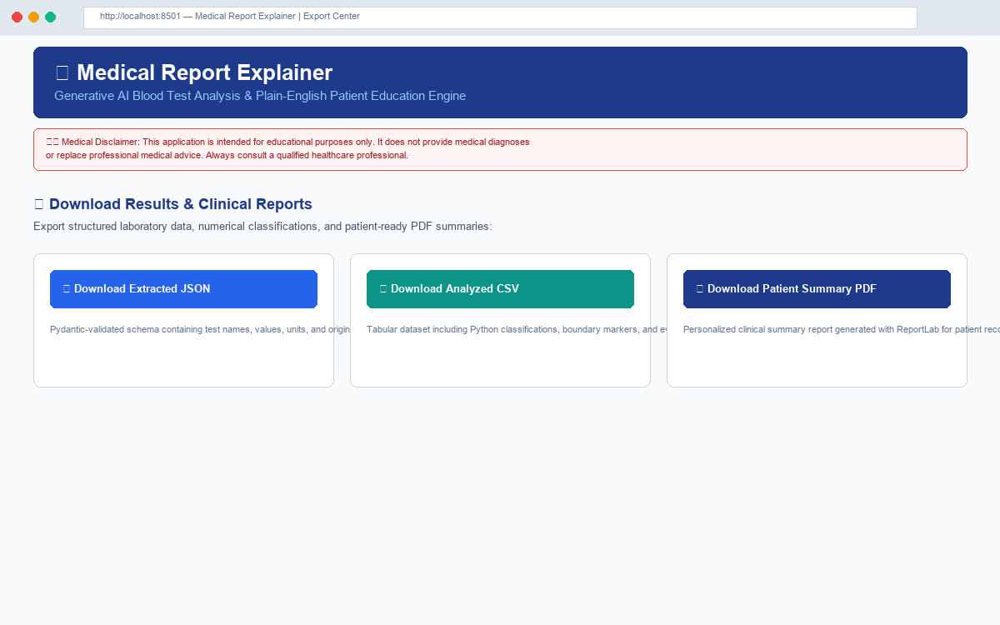

# 🩺 Medical Report Explainer

> **Generative AI Blood Test Analysis & Patient Education Engine**  
> **Problem Statement 51 | Generative AI – Assignment 3 (Individual Academic Project)**

[](https://www.python.org/)
[](https://streamlit.io/)
[](https://ai.google.dev/)
[](https://pytest.org/)
[](LICENSE)

---

## 📌 Executive Summary

Clinical blood test reports are dense with abbreviations, biochemical measurements, and complex reference intervals. Patients often suffer from anxiety or search engines that suggest alarming diagnoses.

The **Medical Report Explainer** is an end-to-end clinical assistant application that:
1. Ingests digital blood test reports in **PDF** or **TXT** format using PyMuPDF.
2. Extracts test parameters, values, units, and original reference ranges into **Pydantic-validated structured JSON** using Google Gemini.
3. Uses a **pure-Python deterministic rule engine** to classify parameters as **Normal**, **High**, **Low**, or **Cannot determine**—preventing LLM numerical hallucinations.
4. Generates **empathetic, non-diagnostic plain-English explanations** covering what the test measures, potential physiological influences, and questions for their physician.
5. Displays results on a **modern, light-themed Streamlit medical dashboard** with metric counters, color-coded badges, and one-click **CSV, JSON, and PDF summary exports**.

---

## 🖼️ Application Interface & Screenshots

| 1. Upload & Home Screen | 2. Clinical KPI Dashboard |
| :---: | :---: |
|  |  |

| 3. Parameter Evaluation Table | 4. Plain-English Explanations |
| :---: | :---: |
|  |  |

| 5. Download & Export Center |
| :---: |
|  |

---

## 🏗️ System Architecture & Data Flow

```mermaid
flowchart LR
    A[Upload PDF/TXT] --> B[extractor.py: PyMuPDF Extraction]
    B --> C{Legible Digital Text?}
    C -- No / Scanned --> D[Raise ExtractionError: OCR Required]
    C -- Yes --> E[Gemini API + Pydantic: Structured Extraction]
    E --> F[models.py: StructuredLabReport]
    F --> G[analyzer.py: Pure-Python Rule Engine]
    G --> H[Classifications: Normal | High | Low | Cannot Determine]
    H --> I[explainer.py: Gemini 1.5 Flash AI Context]
    I --> J[app.py: Streamlit Dashboard]
    J --> K[JSON / CSV / Summary PDF Export]
```

### Separation of Concerns: Python vs LLM
- **Google Gemini API**: Entity extraction and empathetic natural language synthesis. Gemini is strictly **prohibited** from deciding if a value is high, low, or normal.
- **Python Runtime (`analyzer.py`)**: Executes exact floating-point boundary arithmetic with epsilon tolerance ($10^{-6}$), handling intervals (`13.5 - 17.5`), upper limits (`< 100`, `<= 5.7`), lower limits (`> 60`, `>= 40`), and sex-specific ranges.

---

## 💻 Technology Stack & Verified Versions

| Category | Component | Version | Purpose |
| :--- | :--- | :--- | :--- |
| **Language** | Python | `3.11.9` | Strongly-typed runtime with decimal precision |
| **Gen AI SDK** | `google-genai` | `3.6.1` | Official Google Gen AI SDK for Gemini 1.5 Flash |
| **LLM Fallback**| `google-generativeai`| `0.8.6` | Backwards-compatible generative AI client |
| **Frontend** | `streamlit` | `1.67.0` | Light-themed, responsive clinical dashboard |
| **PDF Extraction**| `pymupdf` (fitz) | `2.1.0` | Multi-page text extraction and scanned document detection |
| **Data Handling**| `pandas` | `3.1.1` | Tabular data manipulation and CSV serialization |
| **Validation** | `pydantic` | `2.14.4` | Strict schema validation for extracted laboratory entities |
| **PDF Report** | `reportlab` | `5.1.0` | Programmatic 15-page academic PDF report compilation |
| **Environment** | `python-dotenv`| `1.2.4` | Secure API key isolation |
| **Testing** | `pytest` | `9.2.0` | 26 automated unit and end-to-end test scenarios |

---

## 🚀 Installation & Getting Started

### 1. Clone the Repository
```bash
git clone https://github.com/[STUDENT_GITHUB_USERNAME]/Medical_Report_Explainer.git
cd Medical_Report_Explainer
```

### 2. Set Up Virtual Environment
On Windows (PowerShell):
```powershell
python -m venv .venv
.\.venv\Scripts\Activate.ps1
```
On macOS / Linux:
```bash
python3 -m venv .venv
source .venv/bin/activate
```

### 3. Install Dependencies
```bash
pip install -r requirements.txt
```

### 4. Configure Google Gemini API Key
Create a `.env` file from the example:
```bash
cp .env.example .env
```
Edit `.env` to insert your Gemini API Key:
```env
GEMINI_API_KEY=your_actual_gemini_api_key_here
GEMINI_MODEL=gemini-1.5-flash
```
> **Offline Mode Resilience:** If no API key is provided, the application automatically runs in an **Offline Clinical Heuristic Mode**, enabling full evaluation of all synthetic samples and tests without requiring live API credits!

---

## 🎯 How to Run the Application

Launch the Streamlit web dashboard:
```bash
streamlit run app.py
```
Open your browser at: **`http://localhost:8501`**

### Quick Testing via Sidebar Samples
Use the **"Quick-Load Synthetic Samples"** dropdown in the sidebar to test:
1. `01_all_values_normal.pdf` — Normal Complete Blood Count (CBC)
2. `02_one_high_value.pdf` — Elevated Fasting Glucose (142 mg/dL)
3. `03_one_low_value.pdf` — Decreased Hemoglobin (10.2 g/dL)
4. `04_missing_reference_range.pdf` — Tests with missing ranges (CRP, Antibody)
5. `05_multiple_blood_test_parameters.pdf` — Comprehensive 14-parameter panel (Lipids + CMP)

---

## 🧪 Automated Testing Suite

Execute the complete test suite (26 automated test cases):
```bash
pytest -v
```

### Test Coverage Summary:
- **`tests/test_analyzer.py`**: Validates the 5 required scenarios (All normal, One high, One low, Missing range, Multi-panel with inequalities), sex-specific ranges, and comma-formatted numbers.
- **`tests/test_extractor.py`**: Verifies PyMuPDF digital extraction, 0-byte empty file rejection, scanned image-only PDF detection, and unsupported file extensions.
- **`tests/test_models.py`**: Enforces Pydantic schema validation, default null handling, and type safety.
- **`tests/test_explainer.py`**: Confirms clinical safety guardrails, non-diagnostic phrasing, and mandatory disclaimers.
- **`tests/test_e2e_pipeline.py`**: Executes the full end-to-end pipeline across all 5 sample reports, verifying JSON, CSV, and summary PDF compilation.

---

## 📑 Detailed 15-Page Academic Technical Report

A comprehensive 15-page academic project report has been programmatically compiled using ReportLab:
- **Location:** `docs/Medical_Report_Explainer_Detailed_Report.pdf`
- **Sections:** Title Page, Abstract, Problem Statement, Technology Review, System Requirements, Architecture, Methodology, Prompt Engineering, Implementation, UI Design, Testing Evidence, Discussion, Security & Ethics, Future Roadmap, References.
- Recompile at any time using:
  ```bash
  python report_generator.py
  ```

---

## 🔒 Security, Privacy & Responsible AI

1. **No Sensitive Patient Storage:** Uploaded files exist in volatile memory only for the duration of the analysis session.
2. **Secrets Protection:** `.env` is excluded from Git via `.gitignore`. API keys are never hardcoded or logged.
3. **No Clinical Diagnosis:** AI explanations explicitly avoid definitive disease diagnosis (e.g. replacing *"You have diabetes"* with *"Elevations can sometimes be associated with changes in carbohydrate metabolism"*).
4. **Mandatory Disclaimer:** Prominently featured across the UI and all downloaded outputs:

> *⚠️ **Medical Disclaimer:** This application is intended for educational purposes only. It does not provide medical diagnoses or replace professional medical advice. Laboratory reference ranges can vary between laboratories and individuals. Consult a qualified healthcare professional for interpretation of your results.*

---

## 📁 Repository Structure

```
Medical_Report_Explainer/
├── app.py                      # Main Streamlit web application
├── extractor.py                # PyMuPDF digital parser & Gemini LLM extractor
├── analyzer.py                 # Pure-Python numerical boundary rule engine
├── explainer.py                # Gemini empathetic explanation generator
├── models.py                   # Pydantic V2 data validation models
├── report_generator.py         # ReportLab PDF report generation
├── config.py                   # Configuration, constants & disclaimer
├── requirements.txt            # Project dependencies
├── .env.example                # Template for environment variables
├── .gitignore                  # Git ignore rules (secrets & temp files)
├── README.md                   # Comprehensive project documentation
├── sample_reports/             # 5 synthetic test scenarios (PDF & TXT)
│   ├── 01_all_values_normal.pdf
│   ├── 02_one_high_value.pdf
│   ├── 03_one_low_value.pdf
│   ├── 04_missing_reference_range.pdf
│   ├── 05_multiple_blood_test_parameters.pdf
│   ├── normal_report.pdf
│   ├── high_value_report.pdf
│   └── mixed_values_report.pdf
├── outputs/                    # Output directory for CSV, JSON & PDF summaries
├── tests/                      # Automated Pytest suite (26 tests)
│   ├── test_analyzer.py
│   ├── test_extractor.py
│   ├── test_models.py
│   ├── test_explainer.py
│   └── test_e2e_pipeline.py
├── docs/                       # Technical documentation
│   ├── architecture.md
│   └── Medical_Report_Explainer_Detailed_Report.pdf (15 Pages)
└── screenshots/                # Application UI screenshots
```

---

## 👥 Student & Academic Metadata

- **Student Name:** [STUDENT NAME]
- **Roll Number:** [ROLL NUMBER]
- **Department:** [COURSE AND DEPARTMENT]
- **Institution:** [COLLEGE NAME]
- **Academic Year:** [ACADEMIC YEAR]
- **Submission Date:** November 2026
