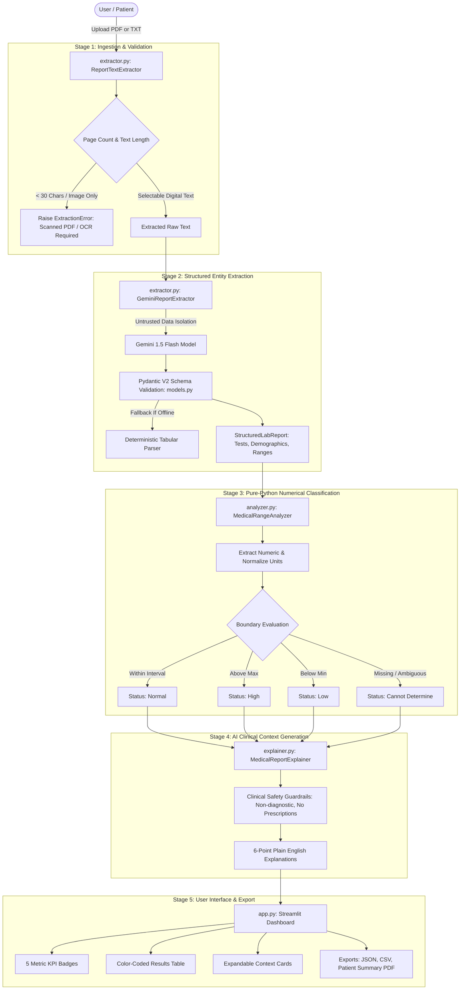

# System Architecture & Technical Specification

## Project Title: Medical Report Explainer (Problem Statement 51)
**Assignment:** Generative AI – Assignment 3  
**Framework:** Hybrid Generative AI & Deterministic Rule Engine

---

## 1. High-Level System Architecture

The Medical Report Explainer uses a decoupled, hybrid architecture. Natural language understanding and patient-friendly explanations are powered by Google Gemini API, while all mathematical comparisons and laboratory threshold classifications are governed strictly by pure Python.

---

## 2. Module Breakdown & Responsibilities

| File | Primary Class / Function | Responsibility | Input | Output |
| :--- | :--- | :--- | :--- | :--- |
| `extractor.py` | `ReportTextExtractor` | Ingests PDF/TXT bytes, verifies character count, rejects scanned image-only PDFs. | Raw File Bytes | Decoded String |
| `extractor.py` | `GeminiReportExtractor` | Calls Gemini API with untrusted data isolation; parses into Pydantic models. | Text String | `StructuredLabReport` |
| `models.py` | `StructuredLabReport`, `ExtractedBloodTest` | Pydantic V2 validation; enforces types, null handling, and nested range boundaries. | Raw JSON / Dict | Validated Objects |
| `analyzer.py` | `MedicalRangeAnalyzer` | Strict rule engine; parses intervals, evaluates float boundaries, classifies status. | Test Parameters | Classification Dictionaries |
| `explainer.py` | `MedicalReportExplainer` | Synthesizes non-alarmist explanations across 6 clinical dimensions with offline fallback. | Analyzed Tests | Explained Dictionaries |
| `report_generator.py`| `generate_academic_technical_report` | Programmatically builds the 15-page academic PDF report. | Project Data | PDF Document |
| `report_generator.py`| `generate_patient_summary_pdf` | Builds a personalized patient summary PDF with tables and medical disclaimer. | Session Results | Patient PDF Report |
| `config.py` | - | Centralized paths, environment loading, constants, and universal medical disclaimer. | Environment | Settings Constants |
| `app.py` | Streamlit Application | Light-themed clinical UI, KPI metric counters, interactive tables, download center. | User Actions | Web Application |

---

## 3. Separation of Concerns: Python vs LLM

A key vulnerability of large language models is numerical instability during floating-point comparisons. In medical informatics, misclassifying an abnormal laboratory finding as normal introduces critical clinical risk.

Our architecture enforces a **deterministic firewall**:
1. **Gemini Extraction**: Extracts test names, raw values, and raw reference intervals. **Gemini is forbidden from deciding if values are normal or abnormal.**
2. **Python Rule Engine**: Executes floating-point comparisons using IEEE-754 arithmetic with an epsilon margin ($10^{-6}$) for float stability:
   $$\text{min} - \epsilon \le \text{value} \le \text{max} + \epsilon \implies \text{Normal}$$
   $$\text{value} > \text{max} + \epsilon \implies \text{High}$$
   $$\text{value} < \text{min} - \epsilon \implies \text{Low}$$
3. **Gemini Explanation**: Receives Python's pre-computed classification. Gemini's role is strictly confined to natural language synthesis, explaining what the test measures, why context matters, and advising medical consultation.

---

## 4. Clinical Safety Guardrails

All generated text is subjected to strict guardrails:
- **No Prescriptions:** The LLM cannot suggest medication, dosages, or self-treatment regimens.
- **No Direct Diagnosis:** Sentences such as *"You have diabetes"* are replaced with *"Elevations can sometimes be associated with changes in carbohydrate metabolism"*.
- **Balanced Language:** Emotional exaggeration and panic-inducing descriptions are prohibited.
- **Mandatory Physician Review:** Every test explanation concludes with actionable guidance to discuss findings with a licensed healthcare provider.
- **Universal Disclaimer:** Displayed prominently on the application header, results dashboard, and all exported PDF summaries.
